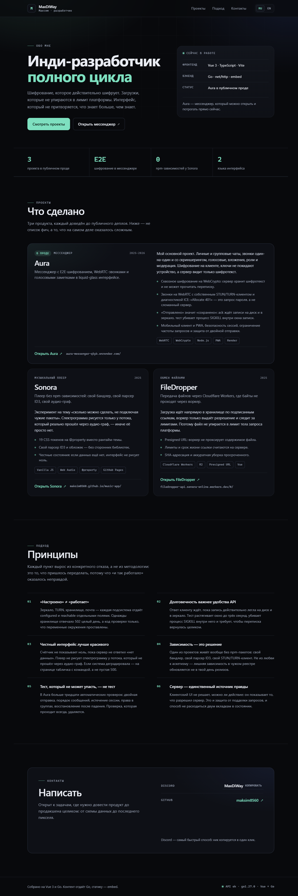
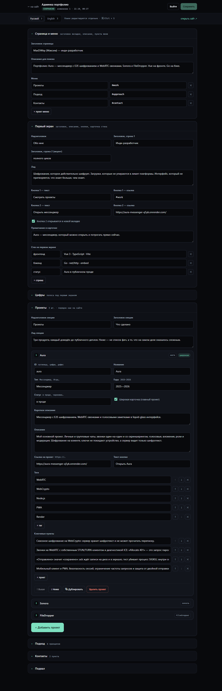

# Портфолио на Vue + Go

Сайт-портфолио: Vue 3 рендерит страницу, Go отдаёт контент через API, раздаёт
собранный фронтенд из встроенной файловой системы и хранит правки в JSON.
Есть админка `/admin`: проекты и весь текст правятся из браузера, без пересборки.





## Что внутри

```
server/            Go-бэкенд (один бинарник)
  main.go          конфиг, graceful shutdown
  app.go           маршруты и JSON API
  content.go       структуры контента + стартовые значения
  store.go         хранилище data/content.json, валидация, атомарная запись
  auth.go          вход в админку, сессии, лимит попыток
  admin.go         CRUD-эндпоинты админки
  lang.go          выбор языка (?lang= → Accept-Language → ru)
  spa.go           раздача dist и SPA-фолбэк
  dist/            сюда собирается фронтенд (встраивается в бинарник)
web/               Vue 3 + TypeScript + Vite
  src/App.vue      страница портфолио
  src/admin/       админка (отдельный чанк, грузится только на /admin)
docs/              скриншоты для README
```

## Запуск

Одной командой:

```powershell
.\build.ps1        # npm install + vite build + go build
cd server; .\portfolio.exe
```

Или по шагам — фронтенд обязан собраться первым, `//go:embed dist` не соберётся
на пустом каталоге:

```powershell
cd web
npm install
npm run build      # положит сборку в ../server/dist

cd ..\server
go run .           # http://localhost:8080
```

Бинарник:

```powershell
cd server
go build -o portfolio.exe .
.\portfolio.exe
```

### Разработка с горячей перезагрузкой

```powershell
# терминал 1
cd server; $env:DEV_ORIGIN="http://localhost:5173"; go run .

# терминал 2
cd web; npm run dev     # http://localhost:5173, /api проксируется на :8080
```

## Админка

Открой `http://localhost:8080/admin`.

Пароль при первом запуске генерируется сам и пишется в `server/data/admin-password.txt`
(он же печатается в консоль). В продакшене задай свой:

```powershell
$env:ADMIN_PASSWORD="длинный-пароль"; .\portfolio.exe
```

Что можно править:

* заголовок и описание страницы, пункты меню;
* первый экран: заголовок, лид, кнопки, карточка стека;
* полосу цифр;
* проекты: добавить, удалить, дублировать, поменять порядок, ссылка на проект,
  теги, ключевые пункты, «широкая карточка» для главного;
* разделы «Подход», «Контакты», подвал;
* всё это отдельно для RU и EN.

Сохранение — кнопка «Сохранить» или `Ctrl/Cmd + S`. Правки применяются сразу:
сайт читает контент из API при загрузке страницы.

## Переменные окружения

| Переменная       | По умолчанию | Зачем                                         |
| ---------------- | ------------ | --------------------------------------------- |
| `PORT`           | `8080`       | порт                                          |
| `DATA_DIR`       | `data`       | где лежат `content.json` и пароль админки      |
| `ADMIN_PASSWORD` | —            | пароль админки; если пусто — файл рядом с данными |
| `DEV_ORIGIN`     | —            | разрешить CORS с Vite (`http://localhost:5173`) |

## API

| Метод | Путь                 | Доступ    | Что делает                        |
| ----- | -------------------- | --------- | --------------------------------- |
| GET   | `/api/content`       | публично  | весь контент страницы на языке    |
| GET   | `/api/projects`      | публично  | только проекты                    |
| GET   | `/api/healthz`       | публично  | статус, версия, uptime, версия Go |
| POST  | `/api/admin/login`   | пароль    | вход, ставит HttpOnly-cookie      |
| POST  | `/api/admin/logout`  | сессия    | выход                             |
| GET   | `/api/admin/session` | публично  | `{authenticated}`                 |
| GET   | `/api/admin/content` | сессия    | документ RU+EN для редактора      |
| PUT   | `/api/admin/content` | сессия    | сохранить документ                |

## Безопасность

* Сессия — HttpOnly + SameSite=Strict, 12 часов, живёт в памяти процесса.
* Пароль сравнивается в постоянном времени, 8 попыток на IP за 5 минут.
* Запись требует заголовок `X-Portfolio-Admin: 1` и проверку Origin — чужой сайт
  такой запрос не отправит.
* Ссылки валидируются: `javascript:` не сохранится.
* `content.json` пишется атомарно, предыдущая версия остаётся в `content.json.bak`.
* `server/data/` в `.gitignore`: там пароль админки и контент, в репозиторий они не попадают.

## Деплой

Собирается в один файл: `npm run build` → `go build`. Дальше любой хостинг,
который умеет запускать бинарник (Render, Fly.io, VPS, Docker). Нужен только
персистентный диск под `DATA_DIR`, иначе правки из админки пропадут при рестарте.
